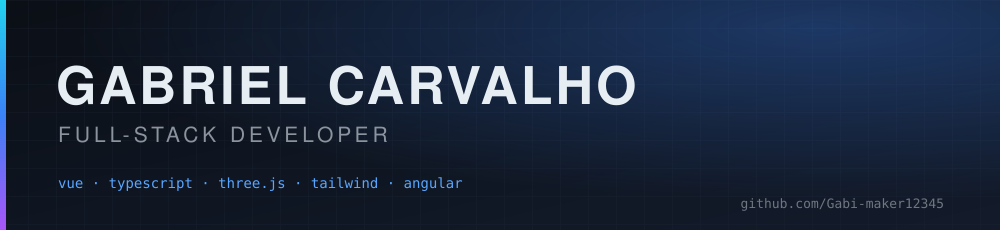

  

  
  
  
  
  
  

  <a href="#projetos">Projetos</a> ·
  <a href="#sobre">Sobre</a> ·
  <a href="https://github.com/Gabi-maker12345?tab=repositories">Repositórios</a>

## Projetos

| Projeto | O que é | Stack |
| :-- | :-- | :-- |
| **[Relics of Space](https://github.com/Gabi-maker12345/Relics-of-Space-Hackathon-NASA)** | Jogo 3D do hackathon da NASA | `Vue 3` · `TypeScript` · `Three.js` |
| **[Gestão de Obras](https://github.com/Gabi-maker12345/Sistema-de-Gest-o-de-Obras-Edifica-)** | Sistema de gerenciamento de obras | `TypeScript` · `PHP` · `Blade` |
| **[Arsenal](https://github.com/Gabi-maker12345/Arsenal)** | Hub colaborativo de gaming entre amigos | `Laravel` · `Blade` |
| **[TaskMind](https://github.com/Gabi-maker12345/TaskMind)** | Agente em Python que observa, detecta e executa tarefas | `Python` |

## Sobre

Dev full-stack. Interface com Vue e Angular, 3D no browser com Three.js, back-end em Laravel/PHP, Java e Python.

> 12 repositórios públicos — o resto está [aqui](https://github.com/Gabi-maker12345?tab=repositories).
